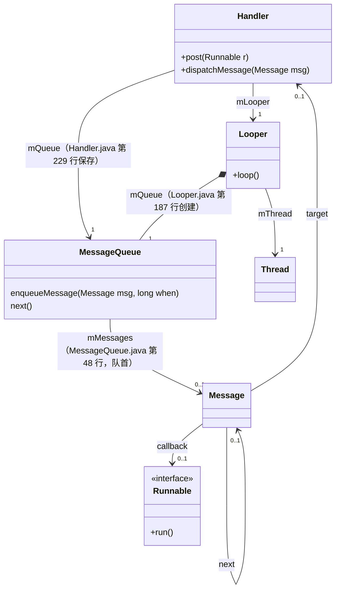
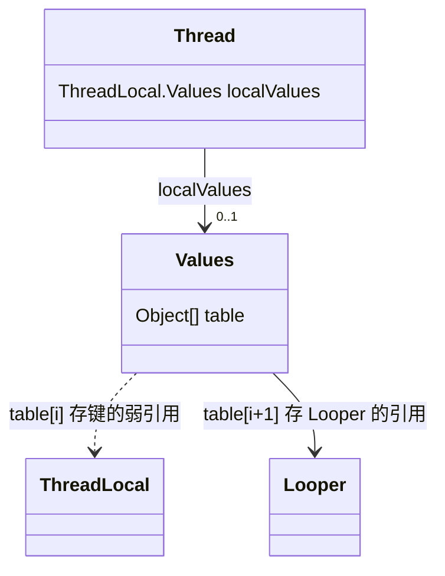
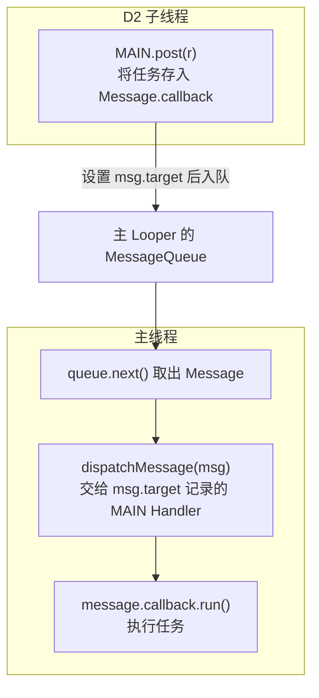

## 复习问题

### 线程、队列和分发

- D2 中，子线程调用了 `MAIN.post(...)`，为什么 `Runnable.run()` 最后是在主线程上执行的？

  **回答。** `MAIN` 创建时绑定了主线程的 Looper，所以子线程调用 `MAIN.post()` 时，任务会进入主线程的消息队列。主线程运行 Looper，从队列取出消息，再交给 `MAIN` 调用任务的 `run()`。因此，子线程负责投递，主线程负责执行。

- 同一进程可以共享变量，为什么还要用 Handler？

  **回答。** 同一进程的线程可以读写共享变量，读取的时机却需要代码安排。下文的示例里，主线程在 `start()` 返回后立刻读取变量，子线程可能还没写入。模拟器上的十次实测中，主线程都先读到了初始值 `1`。子线程可以在结果准备好之后，用 Handler 把处理结果的任务投递到主线程的队列。主线程执行这个任务时，结果就已经准备好了。

- UI 更新为什么由主线程处理？

  **回答。** 普通 Android 页面由主线程统一更新 View 树，布局、绘制和点击回调都在同一条线程上依次处理，避免两个线程同时修改同一个控件。

- 网络操作为什么通常放到后台？

  **回答。** 同步网络请求可能长时间等待服务器响应。把这段等待放到后台，主线程就能继续响应点击和绘制界面。结果准备好后，可以把更新界面的任务投递回主线程。

  子线程也可以在下载结束后，用主 Looper 创建一个 Handler。下面用打印日志来示意投递给主线程的任务：

  ```java
  Handler handler = new Handler(Looper.getMainLooper());
  handler.post(() -> Log.d("Demo", "任务由主线程执行"));
  ```

- 一个线程能有几个 Handler、几个 Looper？

  **回答。** Handler 可以按需创建，多个 Handler 可以绑定同一条线程的 Looper，并共用它的消息队列。每条线程最多有一个 Looper。普通子线程如果没有准备 Looper，就没有自己的 Looper。

- 普通子线程能否创建 Handler？
- 主线程怎样给子线程的 Handler 发消息？

  **回答。** 先让子线程创建并运行自己的 Looper，例如启动一个 `HandlerThread`。主线程拿到子线程的 Looper 后，用它创建 Handler，再调用 `post()`。任务进入子线程的消息队列，由子线程取出并执行。

- 多个 Handler 往同一个队列添加消息时，队列怎样保证线程安全？

  **回答。** 多个 Handler 共用同一个 `MessageQueue` 时，入队和取消息都用 `synchronized (this)` 锁住这个队列对象。一个线程读写链表时，其他线程要等它释放锁。否则，两个线程可能同时读到空队首，后写入的消息会覆盖先写入的消息。

  这把锁也保护等待和唤醒的配合。Looper 持锁检查队列，发现队列为空且需要等待时，先设置 `mBlocked = true`，再释放锁。子线程拿到同一把锁后插入新队首，看到这个标记就调用 `nativeWake()`。主线程在锁外调用 `nativePollOnce()`，进入 native 层的 `epoll_wait()`。如果唤醒通知先到了，`eventfd` 已经可读，等待调用会直接返回，主线程再检查队列。

- `Message` 里面有哪些字段？为什么用 `Message.obtain()`？

  **回答。** `what` 标记消息类型，`arg1`、`arg2` 和 `obj` 携带数据，`target` 指向负责处理的 Handler，`callback` 保存通过 `post()` 投递的任务。`when` 记录最早可执行的时间，`next` 指向队列里的下一条消息。

  `Message.obtain()` 优先从消息池取可复用的对象，池空了才创建新的。Looper 分发完成后会回收消息，减少频繁发送消息带来的对象分配和垃圾回收压力。

- 调用 `sendMessage()` 或 `post()` 后，消息怎样入队、取出和分发？三个回调分支的顺序是什么？

  **回答。** `sendMessage()` 发送已有的消息，`post()` 先把 `Runnable` 装进消息。两条路径最终都由 Handler 将消息入队，Looper 取出后交给目标 Handler 分发。

  1. 消息的 `msg.callback` 有值时，直接执行这个 `Runnable` 的 `run()`。
  2. 消息没有 `Runnable` 时，如果构造 Handler 时传入了 `Handler.Callback`，就调用它的 `handleMessage(msg)`。返回 `true` 表示已处理，分发结束。
  3. 没有构造时传入的回调，或它返回 `false` 时，调用 Handler 自己的 `handleMessage(msg)`。

- 什么是同步屏障？它怎样让异步消息通过？

  **回答。** 同步屏障是消息队列里的一个标记。在 Android 6.0.1 中，队首消息的 `target == null` 表示遇到了屏障。此时，屏障后面的同步消息先等着，`MessageQueue.next()` 会往后找异步消息，找到已到执行时间的异步消息就可以先取出。移除屏障后，原先等着的同步消息就能继续处理。

- Android 11 的 Handler 有哪些变化？

  **回答。** Android 11（API 30）弃用了 `Handler()` 和 `Handler(Callback)` 这两个自动选择当前线程 Looper 的构造方法。创建 Handler 时，建议显式传入希望绑定的 Looper。例如要让任务在主线程执行，可以写 `new Handler(Looper.getMainLooper())`。这样，Handler 使用哪个队列在构造时就写清楚了。 [Android 11 API 差异](https://developer.android.com/sdk/api_diff/30/changes/android.os.Handler)


### 等待、卡顿和泄漏

- Looper 阻塞等消息时，CPU 还能执行其他任务吗？

  **回答。** 可以。Looper 阻塞等消息时，应用主线程处于等待状态。内核调度器可以让这个 CPU 核心执行其他就绪任务。只有当该核心没有可运行的任务时，调度器才会选空闲任务（idle task）。

- `Looper.loop()` 一直循环，为什么通常不会触发 ANR？

  **回答。** Looper 循环让主线程持续处理消息。暂时没有可处理的消息时，主线程会阻塞等待，有输入事件到来时可以被唤醒。输入 ANR 关注的是应用能否及时处理已经到来的输入。例如，主线程在一次回调中长时间处理耗时任务，导致后续输入等待直到超时，就可能触发输入 ANR。

- `postDelayed()` 怎样实现延时？移除延时消息时会唤醒 Looper 吗？

  **回答。** `postDelayed()` 把当前的 `SystemClock.uptimeMillis()` 加上延时，作为消息的最早执行时间 `msg.when`。延时消息按这个时间插入同一条 `MessageQueue`。如果下一条可处理的消息还没到点，`MessageQueue.next()` 就用 `msg.when - now` 算出剩余时间，再通过 `nativePollOnce()` 让底层的 `epoll_wait()` 等待。等待超时或有事件提前唤醒时，主线程会重新检查队列。在 Android 6.0.1 中，`removeCallbacks()` 只把待执行的任务从队列中移除，这次移除本身不发唤醒通知。Looper 等原来的时限到期，或因其他事件醒来后，会重新检查队列。

- `epoll` 如何让主线程等待和唤醒？正常等待和 UI 卡顿怎样区分？

  **回答。** `epoll_wait()` 是 Linux 的系统调用。Android 6.0.1 的 Looper 用它等待已登记的文件描述符就绪，或者等到指定的时限。需要唤醒 Looper 时，投递方往 `eventfd` 写入通知。它变得可读后，内核让 `epoll_wait()` 返回，主线程再检查消息队列。

  正常等待时，主线程暂时没有到点的消息，可以被事件唤醒。D3a 展示了另一种情况：任务已经可以执行，主线程还在之前的耗时回调中。如果绘制因此错过一帧的显示时机，界面就会卡顿。

- 怎样利用消息分发检测卡顿？还可以通过什么方式验证卡顿？

  **用消息分发定位。** 通过主线程的 `Looper.setMessageLogging()`，分别在消息分发开始和结束时记录时间。两次相减得到这条消息占住主线程的时长。把这段时间与帧原定开始的时刻对齐，就能看出那一刻主线程在处理哪条消息。

  **示意图。** 以 60 Hz 为例，下面的时间用于说明这一帧为什么启动得晚。

  ```mermaid
  sequenceDiagram
      participant Main as 主线程
      participant Frame as 帧调度
      Note over Main: 0 ms · 开始处理消息 A
      Note over Main,Frame: 5 ms · 帧原定开始，主线程仍在处理 A
      Note over Main,Frame: 21.7 ms · 一个刷新周期已过，帧还未开始
      Note over Main: 35 ms · 消息 A 处理结束
      Main->>Frame: 36 ms · 开始这一帧的布局和绘制准备
  ```

  这个例子里，帧原定在 5 ms 开始，但主线程直到 35 ms 都在处理消息 A，实际到 36 ms 才开始布局和绘制准备。因此，消息 A 导致这帧错过了原定的刷新时机。排查真实卡顿时，可以再用帧统计核对这帧是否超时。

  **用帧统计验证。** Android 6.0.1 的 `JankTracker` 用 `FrameCompleted - IntendedVsync` 计算帧耗时。达到或超过一个刷新周期时，系统把这帧计为卡顿帧，源码标记为豁免的帠除外。以 60 Hz 屏幕为例，一个刷新周期约为 16.7 ms。可以用 `dumpsys gfxinfo <包名> framestats` 查看帧时间。

- Handler 相关内存泄漏有哪些场景？引用链从哪个 GC Root 出发？如何清理页面退出后仍待执行的任务？

  **引用链。** 以仍在运行的主线程为 GC Root，沿着它的 `ThreadLocal` 存储可以找到主 `Looper`，再从 `MessageQueue` 找到待执行的 `Message`。如果延迟任务捕获了页面，后半段是 `Message.callback → Runnable → Activity`。如果消息的目标是 `Activity` 的非静态内部 `Handler`，后半段是 `Message.target → Handler → Activity`。只要这条强引用链还在，已经退出的页面就无法被回收。

  **避免方法。** 页面销毁时，移除它还没执行的任务。例如，用 `handler.removeCallbacks(updateUi)` 移除之前投递的同一个 `Runnable`。同时取消仍在运行的后台请求，并在更新界面前确认页面仍然有效，防止迟到的结果更新已经销毁的页面。

- IdleHandler 适合做什么？`HandlerThread` 和 `IntentService` 的核心实现是什么？

  **IdleHandler。** 它直接注册到 `MessageQueue`。队列暂时没有到点的消息时，运行该队列的线程会调用它。注册在主线程队列上时，只适合做能很快完成的工作。比如下一条消息还有 2 秒到点，而空闲回调执行了 5 秒，这条消息至少会晚 3 秒才开始执行，因为主线程要等回调返回才能继续取消息。

  **HandlerThread。** 在 Android 6.0.1 中，它启动后会在子线程里准备自己的 Looper 和消息队列，并进入消息循环。需要投递任务时，调用方用它的 Looper 创建 Handler。

  **IntentService。** 它在 `onCreate()` 中启动一个 HandlerThread，再用这条线程的 Looper 创建自己的 `ServiceHandler`。收到 Intent 后，服务通过这个 Handler 投递消息，工作线程依次调用 `onHandleIntent()` 处理请求。

  **为什么用 HandlerThread？** 普通线程也能顺序执行多个任务。例如，在线程里依次调用 A、B、C，如果每个调用都等工作做完才返回，就会先做完 A，再做 B，最后做 C。HandlerThread 自带消息队列和 Looper，线程启动后，其他线程还可以通过 Handler 向它投递新任务。队列暂时为空时，工作线程会等待新消息。IntentService 用这套机制让同一条工作线程依次处理后来收到的 Intent，省去了自己实现排队、等待和唤醒的逻辑。

## 为什么需要 Handler

同一进程里的线程可以共享变量。那为什么还要用 Handler 把结果交回主线程？下面的例子里，子线程把 `anInt` 改成 2，主线程启动子线程后马上读取它。

```java
public class MainActivity extends AppCompatActivity {
    private static final String TAG = "123";
    public static int anInt = 1;

    @Override
    protected void onCreate(Bundle savedInstanceState) {
        super.onCreate(savedInstanceState);
        setContentView(R.layout.activity_main);

        new Thread(new Runnable() {
            @Override
            public void run() {
                anInt = 2;
                Log.i(TAG, "子线程: " + anInt);
            }
        }).start();

        Log.i(TAG, "主线程: " + anInt);
    }
}
```

版权声明：本文为 CSDN 博主「dev晴天」的原创文章，遵循 CC 4.0 BY-SA 版权协议，转载请附上原文出处链接及本声明。 [原文链接](https://blog.csdn.net/qq_38350635/article/details/90440833)

主线程可能读到 1，也可能读到 2。启动子线程后，两条线程各自继续执行，代码里没有建立从子线程写入到主线程读取的顺序。可以在子线程拿到结果之后，通过绑定到主 Looper 的 Handler 投递更新任务。主线程取到这项任务时，再用结果更新界面。

下面的源码说明以 Android 6.0.1 为例。

## Handler、Looper 和 MessageQueue

| 组件 | 作用 |
| --- | --- |
| `Handler` | 把消息送进它所绑定的 Looper 的队列，并在分发时处理发给自己的消息。 |
| `Looper` | 在所属线程上运行消息循环，从队列取出消息，交给消息指定的 Handler。 |
| `MessageQueue` | 保存待执行的消息，内部用 `Message.next` 把消息连成链表。取消息时也负责等待。 |
| `Message` | 保存消息类型 `what`、数据 `obj`、执行时间 `when`、目标 `target` 等信息。通过 `post()` 发送的 `Runnable` 保存在 `callback` 字段。 |

### Handler 与 Looper 的类图

箭头旁标的是源码字段名。`Handler.mQueue` 和它绑定的 `Looper.mQueue` 指向同一个队列。



### 主线程的 Looper 从哪里来

应用启动时，主线程在 `ActivityThread.main()` 中调用 `Looper.prepareMainLooper()`。这一步创建 Looper 和它的消息队列，再把这个 Looper 登记为主 Looper。稍后，同一条主线程调用 `Looper.loop()`，开始取消息并分发。

```java
Handler mainHandler = new Handler(Looper.getMainLooper());
```

构造 Handler 时传入主 Looper，Handler 会保存它和它的 `MessageQueue`。以后，无论在哪条线程调用 `mainHandler.post()`，任务都会进入主线程的队列。主线程在自己的循环里取出任务，再调用它的 `run()`。所以判断任务在哪条线程执行，要看创建 Handler 时选的是哪个 Looper。

### 子线程的 Looper 和 ThreadLocal

Android 用 `ThreadLocal` 保存每条线程自己的 Looper。`Looper.myLooper()` 返回当前线程的值。`Looper.prepare()` 先检查这个值，已经有 Looper 就抛出异常，所以一条线程最多创建一个 Looper。多个 Handler 可以共享这个 Looper 和它的队列。

#### ThreadLocal 怎样存放 Looper

在 Android 6.0.1 中，每个 `Thread` 对象都有自己的 `localValues` 字段，类型是 `ThreadLocal.Values`。这个存储对象按需创建，里面的 `Object[] table` 用来保存该线程的多组键和值。下图右侧只画出保存 Looper 的那一组。



1. `Looper.sThreadLocal` 是 Looper 类里的静态字段，指向用来查找 Looper 的 `ThreadLocal` 对象。不同线程可以使用同一个键。
2. 调用 `sThreadLocal.set(looper)` 时，Looper 的引用会存入当前线程的 `localValues` 字段所指对象的 `Object[] table` 数组中。对 Looper 这一项，`table[i]` 保存键的弱引用，紧挨着的 `table[i + 1]` 保存 Looper 对象的引用。
3. 这条线程以后调用 `Looper.myLooper()` 时，`sThreadLocal.get()` 会在它自己的表里查这个键，命中后读取右边那一格。

普通子线程可以直接使用已有的主线程 Handler 来发送消息。要让子线程自己通过 Handler 接收任务，可以在子线程里先调用 `Looper.prepare()`，创建 Handler，再调用 `Looper.loop()`。需要持续处理任务时，也可以使用 `HandlerThread`，它会在自己的线程里完成准备和循环。

```java
new Thread(() -> {
    Looper.prepare();
    Handler handler = new Handler(Looper.myLooper());
    // 在进入循环前，把 handler 安全地交给需要投递任务的一方。
    Looper.loop();
}).start();
```

旧代码常用无参数的 `new Handler()`。它会用 `Looper.myLooper()` 查找当前线程的 Looper。普通子线程如果没有调用过 `Looper.prepare()`，这种写法会抛出异常。子线程的消息循环结束使用后，可以通过 `quit()` 或 `quitSafely()` 退出。

**用日志验证 ThreadLocal**

```java
ThreadLocal<String> local = new ThreadLocal<>();
local.set("我是主线程");
Log.d(TAG, "主线程: " + local.get());

new Thread(() -> {
    local.set("我是线程 1");
    Log.d(TAG, "线程 1: " + local.get());
}).start();

new Thread(() -> {
    Log.d(TAG, "线程 2: " + local.get());
}).start();
```

三条线程访问同一个 `ThreadLocal` 对象，看到的值分别是「我是主线程」「我是线程 1」和 `null`。两条子线程的日志先后取决于调度。这个例子对应 Looper 的保存方式。参考《Android 开发艺术探索》第 377 页。

## 一条消息怎样从发送走到执行

以 Lab 2 的 D2 为例，`MAIN` 在构造时绑定主线程的 Looper。下面跟踪同一条消息从投递到执行的过程。



### 1. Handler 投递到队列

`sendMessage(msg)` 发送一条已有的消息。`post(runnable)` 先通过 `getPostMessage()` 把任务放进消息的 `callback` 字段，再走同一条发送路径。

```java
public final boolean post(Runnable r) {
    return sendMessageDelayed(getPostMessage(r), 0);
}
```

消息最终经过 `sendMessageAtTime()`，进入 Handler 保存的队列。入队前，Handler 把自己写到 `msg.target`。到达 `MessageQueue.enqueueMessage()` 后，队列在 `synchronized (this)` 内按执行时间插入链表。取消息和移除消息时也用同一把队列锁保护链表。

### 2. Looper 取出待处理的消息

运行 `Looper.loop()` 的线程调用 `queue.next()`。有到点的消息时，`next()` 从链表里取出一条并返回。Looper 根据 `msg.target` 找到接收它的 Handler，再调用 `dispatchMessage()`。

```java
Message msg = queue.next(); // 暂时没有可处理的消息时，这里可能等待。
// 省略退出条件和日志。
msg.target.dispatchMessage(msg);
```

### 3. Handler 执行回调

`dispatchMessage()` 依次检查下面三个分支：

1. 如果 `msg.callback` 有值，调用这个 `Runnable` 的 `run()`。这是 `post()` 走的路径。
2. 否则，如果构造 Handler 时传入了 `Handler.Callback`，调用它的 `handleMessage()`。它返回 `true` 时，分发结束。
3. 其余情况调用 Handler 自己的 `handleMessage()`。

分发和回调都是正在运行 Looper 的那条线程里的普通方法调用。从子线程投递到主线程时，线程之间通过队列交接消息。

相关源码是 `frameworks/base/core/java/android/os/` 下的 `Handler.java`、`Looper.java` 和 `MessageQueue.java`。

## 延时消息、主线程等待和 ANR

### 延时消息到点后怎样执行

`postDelayed(r, delayMillis)` 用 `SystemClock.uptimeMillis()` 加上延时得到消息的执行时间 `when`。队列按这个时间排序。如果下一条可处理的消息还没到点，`MessageQueue.next()` 算出 `when - now`，把剩余时间传给 `nativePollOnce()`。等待到期后，主线程重新检查队列，然后处理已到点的消息。

这个时间表示消息最早何时可以执行。即使 `post()` 的延时为零，主线程也要等当前回调返回，才有机会取下一条消息。

### Looper 等待时怎样唤醒

暂时没有可处理的消息时，主线程可以在 native 层的 `epoll_wait()` 中阻塞。Android 6.0.1 的 Looper 用 `eventfd` 作为主动唤醒的通知通道。如果队列正在等，而且新消息插到了队首，入队代码会调用 `nativeWake()`，让 Looper 往 `eventfd` 写入通知。等待返回后，主线程重新检查队列。同步屏障在队首时，插入首个可绕过屏障的异步消息也可能触发唤醒。

已经有延时消息时，等待还可以因为超时而返回。其他被监控的文件描述符就绪，也能让 `epoll_wait()` 返回。可以在 `frameworks/base/core/jni/android_os_MessageQueue.cpp` 和 `system/core/libutils/Looper.cpp` 对照这条路径。

**移除延时消息会唤醒主线程吗？** Android 6.0.1 的普通 `removeMessages()` 和 `removeCallbacks()` 通过修改队列取消待执行项，本身不会调用 `nativeWake()`。主线程在已有的等待结束，或被其他事件唤醒后，再检查更新过的队列。

### 主线程一直运行 Looper，为什么通常不会触发 ANR

Looper 循环让主线程能持续处理输入、生命周期回调和应用自己投递的任务。暂时没有工作时，主线程在内核里等事件或超时，CPU 可以去执行其他就绪任务。只有这个核心没有可运行的任务时，调度器才会选空闲任务。

输入 ANR 看的是输入能否及时得到处理。例如，如果主线程在 `onCreate()` 或点击回调里长时间执行耗时操作，后续输入便可能等到系统超时。Lab 2 的 D3a 就展示了同一个机制：任务已经投递，主线程仍在当前点击回调里，队列里的任务只能继续等。

## 同步消息、异步消息和同步屏障

普通 Handler 默认发送同步消息。创建 Handler 时如果设置了 `async`，它发送的消息会被标记为异步。两者都进入同一个队列，由同一条 Looper 线程处理。

当同步屏障到达队首，`MessageQueue.next()` 通过 `target == null` 识别屏障，向后查找异步消息。已到点的异步消息可以绕过屏障。屏障移除后，原来被挡住的同步消息可以继续分发。屏障可用于让界面绘制相关的消息及时处理。已经开始运行的回调仍会占用这条线程，异步消息也要等线程回到队列。

## IdleHandler 什么时候执行

当队列为空，或队首消息还没到执行时间时，`MessageQueue.next()` 可以调用已注册的 `IdleHandler.queueIdle()`。返回 `false` 会移除这个 IdleHandler。返回 `true` 会保留它，供之后空闲时再次调用。

```kotlin
Looper.myQueue().addIdleHandler {
    Log.i("HandlerActivity", "width ${btFive.width} height ${btFive.height}")
    false
}
```

主队列的 IdleHandler 仍在主线程上执行，适合短小、可以延后的工作，例如把部分非必要初始化移出启动回调。上面的例子可以用于观察控件宽高。需要等布局完成再读尺寸时，可以使用 `ViewTreeObserver.OnGlobalLayoutListener`。队列空闲和某个 View 完成布局是两个时机。

## 参考资料

- 消息队列和分发：[入队算法笔记](https://www.jianshu.com/p/9efe3b48b730)、[Handler 源码笔记](https://juejin.cn/post/6844904113470177293)、[视频讲解](https://www.bilibili.com/video/BV1VE411Z7Ay?p=4)、[郭霖的 Handler 文章](http://blog.csdn.net/guolin_blog/article/details/9991569)。
- 延时与唤醒：[延时消息源码](https://www.jianshu.com/p/68083d432b3f)、[知乎笔记](https://zhuanlan.zhihu.com/p/260661053)、[CSDN 笔记](https://blog.csdn.net/thh159/article/details/103644489)、[主线程循环与休眠](https://www.jianshu.com/p/a7969d73c120)。
- 同步屏障与空闲回调：[异步消息与同步屏障](https://blog.csdn.net/ly502541243/article/details/109091386)、[IdleHandler 笔记](https://blog.csdn.net/ZYJWR/article/details/103086664)、[IdleHandler 问答](https://www.wanandroid.com/wenda/show/8723)。
- 延伸阅读：[Handler 问题整理](https://juejin.cn/post/6844904150140977165)、[Handler 视频](https://www.bilibili.com/video/BV1A7411M7zQ)、[小专栏笔记](https://xiaozhuanlan.com/topic/0843791256)、[Glide 中的 Handler 用法](https://www.bilibili.com/video/BV1FU4y1V7HE)、[SegmentFault 文章](https://segmentfault.com/a/1190000039809784)。原笔记还提到可查看 LeakCanary 中的空闲回调用法。
