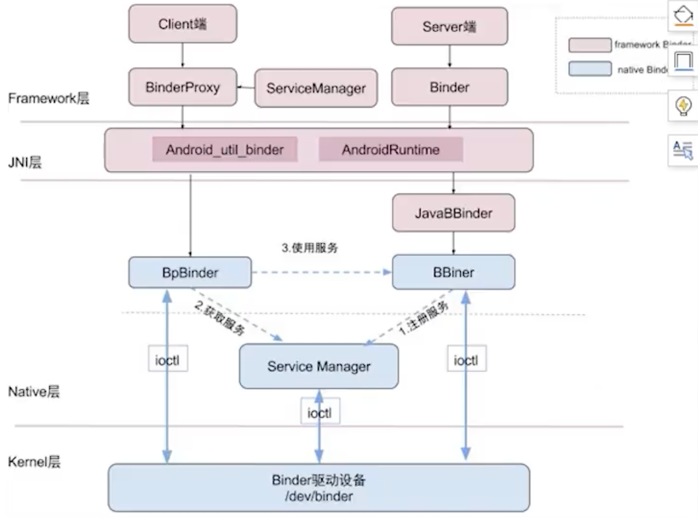
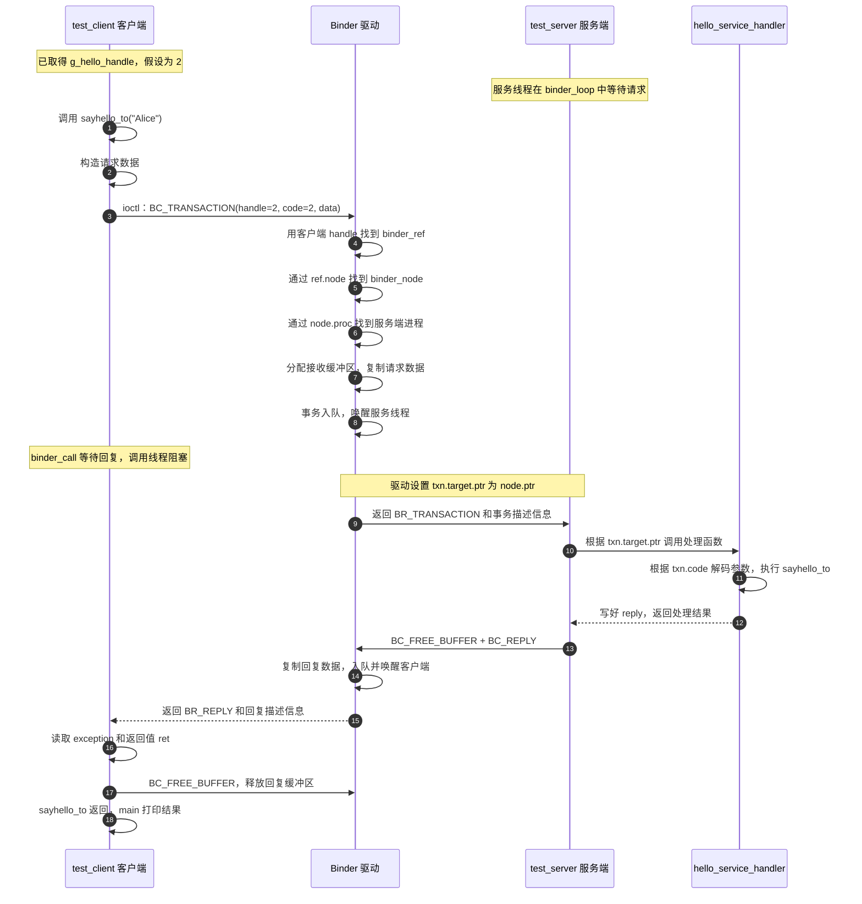
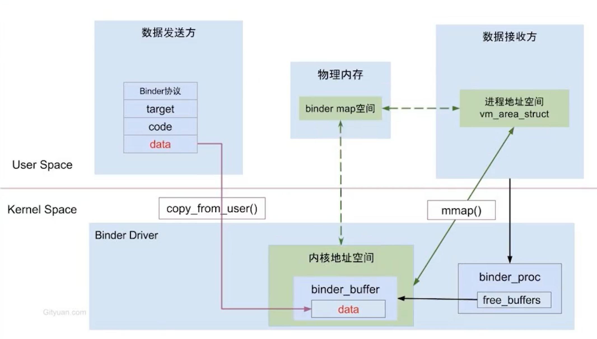
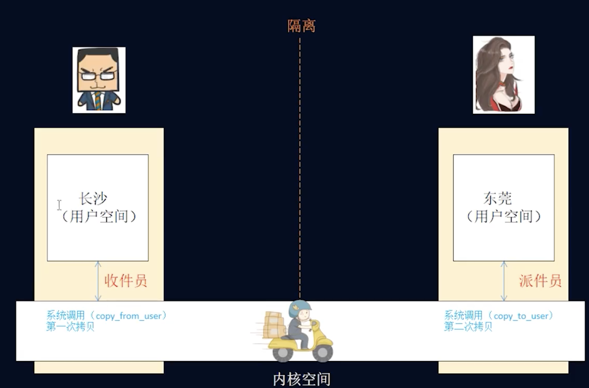
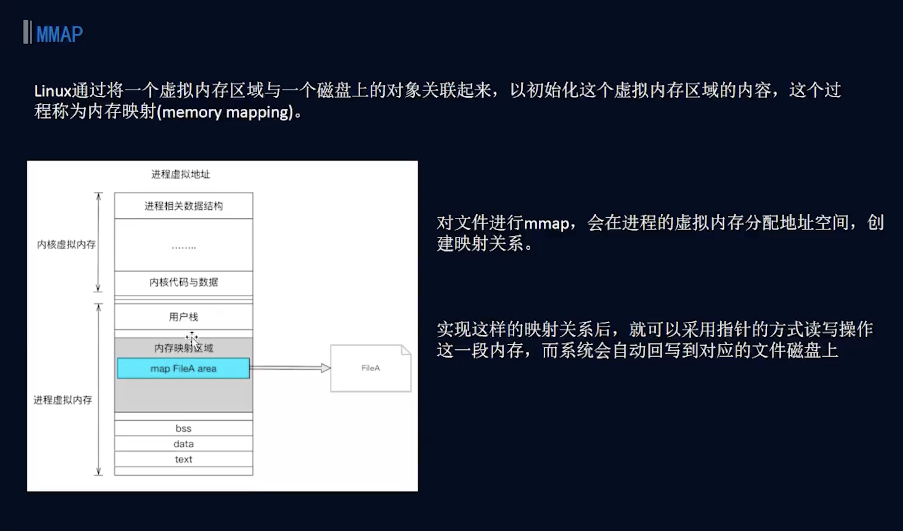

这篇文章用一个 C 语言 Binder 示例，串起服务注册、客户端查找服务、发送事务、服务端处理和返回结果。后半部分提供本机 Android 模拟器上的逐步操作命令，可以边运行边对照日志。

> **先抓住一条主线：**客户端把请求编码成 Parcel 风格的数据，通过 Binder 驱动交给服务端；服务端执行方法后，通过驱动把结果送回客户端。

## 1. Binder 解决什么问题

Android 应用和系统服务通常运行在不同进程中。进程间需要交换数据，也需要管理服务查找、对象引用和并发访问。

| 方式     | 主要用途                              | 需要留意的地方                                        |
| -------- | ------------------------------------- | ----------------------------------------------------- |
| 信号量   | 协调进程或线程的访问顺序              | 负责同步，不直接传递业务数据                          |
| 共享内存 | 让多个进程读写同一片映射区域          | 双方要自行约定数据格式、锁和生命周期                  |
| Socket   | 通过字节流或数据报交换消息            | 需要自行处理连接、协议和数据编解码                    |
| Binder   | 面向 Android 服务的对象调用和消息传递 | 使用 Binder 驱动、对象句柄和 Service Manager 管理服务 |

多进程可以隔离崩溃和资源使用，也适合让独立进程维护持续运行的通信任务。进程之间需要调用服务时，Binder 提供了统一的请求和回复路径。

## 2. 一次 Binder 调用经过哪些角色

示例中有客户端 `test_client`、服务端 `test_server`、内核 Binder 驱动和 Android 系统自带的 Service Manager。`hello`、`goodbye` 是服务名；服务端注册它们，客户端查询后取得本进程可用的 handle。



### 2.1 先查找服务

客户端先向 handle `0`（Service Manager）发起查询。查询成功后得到服务 handle，例如本次运行中的 `hello` 是 `2`。handle 是 Binder 驱动分配给当前进程使用的引用，不应假设它在每次启动或每个进程中都固定。

Android 模拟器已有系统 Service Manager，所以本例只运行 `test_server` 和 `test_client`，不再启动工程自己的 `service_manager`。

### 2.2 再调用 `sayhello_to("Alice")`

下面的时序图从客户端已经取得 `g_hello_handle` 后开始，假设本次 handle 为 `2`。图中的 18 个步骤与下方文字说明一一对应。点击图表或按钮可放大查看。

此时服务注册和查询已经完成：驱动中已有 hello 服务的 `binder_node`，以及客户端指向它的 `binder_ref`。客户端和服务端也已经通过 `binder_open()` 建立 Binder 接收缓冲区的 `mmap` 映射。`hello_service_handler` 是服务端进程中的函数，图中单独列出它是为了展示函数调用过程。

<style>
.markdown-body pre:has(> code.mermaid) {
  overflow: hidden;
  padding: 8px;
  background: transparent;
  cursor: zoom-in;
}
.markdown-body pre > code.mermaid {
  display: block;
  line-height: 0;
}
.markdown-body pre > code.mermaid > svg {
  display: block;
  width: 100% !important;
  min-width: 0 !important;
  max-width: 100% !important;
  height: auto !important;
}
#binder-diagram-viewer {
  width: 96vw; max-width: 1600px; height: 90vh; max-height: 90vh;
  padding: 0; border: 0; border-radius: 12px; background: #fff; color: #20252b;
}
#binder-diagram-viewer::backdrop { background: rgba(0, 0, 0, .72); }
#binder-diagram-viewer .diagram-toolbar {
  display: flex; flex-wrap: wrap; align-items: center; gap: 8px;
  padding: 12px; border-bottom: 1px solid #ddd;
}
#binder-diagram-viewer button, #binder-diagram-open {
  padding: 6px 12px; border: 1px solid #aaa; border-radius: 6px;
  background: #fff; color: #20252b; cursor: pointer; font: inherit;
}
#binder-diagram-viewer button:focus-visible, #binder-diagram-open:focus-visible {
  outline: 3px solid #1674c5; outline-offset: 2px;
}
#binder-diagram-viewer .diagram-title { margin-right: auto; }
#binder-diagram-viewer .diagram-viewport {
  position: relative; flex: 1; min-height: 0; overflow: hidden;
  touch-action: none; cursor: grab; background: #fff;
}
#binder-diagram-viewer .diagram-viewport:active { cursor: grabbing; }
#binder-diagram-viewer .diagram-viewport img {
  position: absolute; left: 50%; top: 50%; max-width: none; max-height: none;
  transform-origin: center; user-select: none; pointer-events: none;
}
#binder-diagram-viewer[open] { display: flex; flex-direction: column; }
#binder-diagram-viewer .diagram-help { padding: 8px 12px; margin: 0; font-size: 14px; }
</style>

<button type="button" id="binder-diagram-open">放大查看时序图</button>



<script>
(() => {
  const button = document.getElementById('binder-diagram-open');
  const article = button.closest('.markdown-body');
  const preview = article.querySelector('pre:has(> code.mermaid)');
  const dialog = document.createElement('dialog');
  dialog.id = 'binder-diagram-viewer';
  dialog.setAttribute('aria-labelledby', 'binder-diagram-title');
  dialog.innerHTML = '<div class="diagram-toolbar"><strong class="diagram-title" id="binder-diagram-title">Binder 调用时序</strong><button type="button" data-action="out" aria-label="缩小图表">−</button><output aria-label="缩放比例"></output><button type="button" data-action="in" aria-label="放大图表">＋</button><button type="button" data-action="fit">适应窗口</button><button type="button" data-action="close">关闭</button></div><div class="diagram-viewport"></div><p class="diagram-help">滚轮或按钮缩放 · 拖动查看细节 · Esc 关闭</p>';
  document.body.appendChild(dialog);
  const viewport = dialog.querySelector('.diagram-viewport');
  const picture = dialog.querySelector('img');
  const output = dialog.querySelector('output');
  let scale = 1, x = 0, y = 0, chartWidth = 1, chartHeight = 1;
  let fitScale = 1, objectUrl, drag, returnFocus;
  function paint() {
    picture.style.transform = `translate(-50%, -50%) translate(${x}px, ${y}px) scale(${scale})`;
    output.textContent = Math.round(scale * 100) + '%';
  }
  function fit() {
    fitScale = Math.min((viewport.clientWidth - 32) / chartWidth, (viewport.clientHeight - 32) / chartHeight, 1);
    scale = fitScale; x = 0; y = 0; paint();
  }
  function zoom(factor, px = 0, py = 0) {
    const next = Math.max(Math.min(fitScale, .1), Math.min(4, scale * factor));
    const ratio = next / scale;
    x = px - (px - x) * ratio; y = py - (py - y) * ratio;
    scale = next; paint();
  }
  function open() {
    const source = preview.querySelector('svg');
    if (!source || dialog.open) return;
    const copy = source.cloneNode(true);
    const box = source.viewBox.baseVal;
    chartWidth = box.width || source.getBoundingClientRect().width;
    chartHeight = box.height || source.getBoundingClientRect().height;
    copy.setAttribute('xmlns', 'http://www.w3.org/2000/svg');
    copy.setAttribute('width', chartWidth); copy.setAttribute('height', chartHeight);
    copy.style.cssText = 'background:white;';
    if (objectUrl) URL.revokeObjectURL(objectUrl);
    objectUrl = URL.createObjectURL(new Blob([new XMLSerializer().serializeToString(copy)], { type: 'image/svg+xml' }));
    picture.src = objectUrl;
    picture.style.width = chartWidth + 'px'; picture.style.height = chartHeight + 'px';
    returnFocus = document.activeElement;
    dialog.showModal(); fit();
  }
  button.addEventListener('click', open);
  preview.setAttribute('tabindex', '0');
  preview.setAttribute('role', 'button');
  preview.setAttribute('aria-label', '放大查看 Binder 时序图');
  preview.addEventListener('click', open);
  preview.addEventListener('keydown', event => {
    if (event.key === 'Enter' || event.key === ' ') { event.preventDefault(); open(); }
  });
  dialog.addEventListener('click', event => {
    const action = event.target.dataset.action;
    if (action === 'close') dialog.close();
    if (action === 'fit') fit();
    if (action === 'in') zoom(1.25);
    if (action === 'out') zoom(.8);
    if (event.target === dialog) {
      const rect = dialog.getBoundingClientRect();
      if (event.clientX < rect.left || event.clientX > rect.right || event.clientY < rect.top || event.clientY > rect.bottom) dialog.close();
    }
  });
  dialog.addEventListener('close', () => {
    drag = null; picture.removeAttribute('src');
    if (objectUrl) { URL.revokeObjectURL(objectUrl); objectUrl = null; }
    if (returnFocus && returnFocus.isConnected) returnFocus.focus();
  });
  viewport.addEventListener('wheel', event => {
    event.preventDefault();
    const rect = viewport.getBoundingClientRect();
    zoom(Math.exp(-event.deltaY * .002), event.clientX - rect.left - rect.width / 2, event.clientY - rect.top - rect.height / 2);
  }, { passive: false });
  viewport.addEventListener('pointerdown', event => {
    if (!event.isPrimary || event.button !== 0) return;
    drag = { id: event.pointerId, x: event.clientX, y: event.clientY };
    viewport.setPointerCapture(event.pointerId);
  });
  viewport.addEventListener('pointermove', event => {
    if (!drag || drag.id !== event.pointerId) return;
    x += event.clientX - drag.x; y += event.clientY - drag.y;
    drag.x = event.clientX; drag.y = event.clientY; paint();
  });
  viewport.addEventListener('pointerup', () => { drag = null; });
  viewport.addEventListener('pointercancel', () => { drag = null; });
  window.addEventListener('resize', () => { if (dialog.open) fit(); });
})();
</script>

#### 时序图逐步说明

图中 `ref.node`、`node.proc`、`node.ptr` 分别对应 C 代码中的 `ref->node`、`node->proc`、`node->ptr`。编号表示一次成功同步调用的逻辑流程；线程实际运行和唤醒的时机由调度器决定。

| 步骤 | 文字解释 |
| --- | --- |
| **1. 调用客户端函数** | `main()` 调用客户端的 `sayhello_to("Alice")`，开始准备一次跨进程请求。 |
| **2. 构造请求数据** | 用 `bio_init()` 初始化数据容器，再写入严格模式头、接口名 `IHelloService` 和参数 `"Alice"`。 |
| **3. 请求进入驱动** | `binder_call()` 设置 `target.handle=2`、`code=2` 和数据地址，通过 `ioctl(BINDER_WRITE_READ)` 提交 `BC_TRANSACTION`。handle 指定服务，code 指定操作；这里 `code=2` 对应 `HELLO_SVR_CMD_SAYHELLO_TO`。 |
| **4. handle 找 ref** | 驱动在客户端自己的引用表 `refs_by_desc` 中查找 `desc=2` 的 `binder_ref`。相同 handle 数字在不同进程中可以指向不同服务。 |
| **5. ref 找 node** | 通过 `ref->node` 找到 hello 服务的 `binder_node`。ServiceManager 和客户端各自的 ref，都可以指向这个 node。 |
| **6. node 找服务端** | `node->proc` 指向 `test_server` 对应的内核进程记录 `binder_proc`，驱动由此确定接收请求的进程。 |
| **7. 复制请求数据** | 驱动从服务端的 Binder 接收缓冲区中分配空间，用 `copy_from_user()` 将客户端请求数据复制进去。服务端通过已有的 mmap 映射读取这份数据。 |
| **8. 排队并唤醒** | 驱动把事务放入目标进程或线程的待处理队列，唤醒等待请求的服务线程。客户端调用线程等待回复。 |
| **9. 服务端收到事务** | 服务线程读取驱动时得到 `BR_TRANSACTION`。驱动设置 `txn.target.ptr = node->ptr`，并提供请求数据在服务端用户空间中的地址。 |
| **10. 进入处理函数** | `binder_loop()` 经 `binder_parse()` 调用 `test_server_handler()`，后者把 `txn.target.ptr` 转成函数指针，进入 `hello_service_handler()`。 |
| **11. 执行业务函数** | `hello_service_handler()` 根据 `txn.code=2` 选择操作，读取参数 `"Alice"`，调用服务端的 `sayhello_to("Alice")`，打印信息并返回计数值 `cnt`。 |
| **12. 构造回复** | 处理函数向 `reply` 写入异常码 `0` 和返回值 `cnt`，然后返回到接收请求的处理流程。 |
| **13. 提交回复** | 服务端发送 `BC_FREE_BUFFER` 释放已处理的请求缓冲区，并通过 `BC_REPLY` 提交回复数据；本工程把两个命令一起发送给驱动。 |
| **14. 驱动传递回复** | 驱动根据已保存的事务关系找到等待回复的客户端线程，把回复数据复制到客户端的接收缓冲区，排队并唤醒它。 |
| **15. 客户端收到回复** | 客户端从驱动读取到 `BR_REPLY`。`binder_parse()` 将回复数据的位置交给 `reply`，`binder_call()` 随后返回。 |
| **16. 读取业务结果** | 客户端的 `sayhello_to()` 先读取异常码，成功时再读取计数值，保存为 `ret`。 |
| **17. 释放回复缓冲区** | 客户端调用 `binder_done()`，发送 `BC_FREE_BUFFER`，通知驱动回收这次回复占用的缓冲区。 |
| **18. 返回调用结果** | 客户端的 `sayhello_to()` 返回 `ret`，`main()` 打印结果，例如 `get ret of sayhello_to = 1`。 |

#### binder_ref 和 binder_node 在哪里起作用

**第 4～6 步完成服务定位，第 9～10 步使用服务端处理函数地址。** `binder_ref` 和 `binder_node` 都由驱动在内核中维护，用户态客户端使用的是整数 handle。

```text
客户端的 handle
      ↓ 第 4 步：在客户端的引用表中查找
客户端的 binder_ref
      ↓ 第 5 步：ref->node
hello 的 binder_node
      ├─ node->proc → 第 6 步：确定服务端进程
      └─ node->ptr  → 第 9～10 步：确定服务端处理函数
```

本工程注册 hello 服务时使用 `hello_service_handler` 的函数地址作为对象标识，所以 `node->ptr` 保存的是这个地址。服务端收到事务时，驱动将它放回 `txn.target.ptr`，供 `test_server_handler()` 分发调用。ServiceManager 参与前面的注册和查询；这张图中的业务调用通过驱动直接交给服务端。

**第 7 步体现请求数据的一次复制，第 14 步是回复方向的数据复制。** 接收缓冲区的内核映射与接收进程的用户映射访问同一份物理内存，因此接收方可以直接读取数据主体。第 9、15 步仍需要把事务描述信息交给用户态；“一次复制”指单个传输方向的数据主体，不表示整个请求和回复过程总共只复制一次。

### 2.3 如何读调试日志

| 日志                      | 说明                                 |
| ------------------------- | ------------------------------------ |
| `BC_TRANSACTION`          | 客户端提交一个事务给驱动             |
| `BR_TRANSACTION`          | 服务端从驱动收到事务                 |
| `BC_REPLY`                | 服务端提交回复                       |
| `BR_REPLY`                | 客户端收到回复                       |
| `BR_TRANSACTION_COMPLETE` | 事务已提交完成；它本身不是业务返回值 |

客户端日志中的 `handle=0 code=2` 是查找服务。之后的 `handle=2 code=2` 才是发给 `hello` 的方法调用。事务数据包含接口名 `IHelloService` 和名字 `Alice`。

服务端在 `hello_service_handler()` 中读取事务码和参数，调用 `sayhello_to(name)`，并依次写入异常码与计数值。回复共 8 字节：前 4 字节是异常码 `0`，后 4 字节是整数结果。客户端读出结果后打印 `get ret of sayhello_to = 1`。

## 3. Binder 缓冲区与内存映射

Binder 为事务数据提供映射缓冲区。映射让接收方可以直接读取驱动准备的事务数据，减少用户空间之间额外的数据搬运。具体的内核映射和复制过程见下图。



传统 IPC 和 Binder 的数据路径对照：






## 4. 在 Android 模拟器上逐步调试

本机已有 AOSP 6.0.1 `generic_x86` 镜像和 32 位 Binder 内核。以下命令在两个终端窗口中执行，不需要 ARM 开发板。

### 第一步：终端一启动模拟器

在终端一进入示例工程并启动模拟器，保持这个终端打开：

```bash
cd /home/m/Documents/binder/APP_0003_Binder_C_App
bash scripts/start-emulator.sh
```

如果模拟器已经启动，不要再开第二个实例。在终端二检查设备：

```bash
adb -s emulator-5560 shell getprop sys.boot_completed
```

输出 `1` 表示系统已经启动。若启动脚本提示模拟器实例太多或 userdata 镜像正在使用，先检查 ADB 设备并复用已启动的模拟器；不要删除或重建 `build/emulator/state`。

### 第二步：终端二编译并推送程序

```bash
cd /home/m/Documents/binder/APP_0003_Binder_C_App
bash scripts/build-emulator.sh
adb -s emulator-5560 push build/emulator/test_server build/emulator/test_client /data/local/tmp/
```

编译成功会显示 `Built: .../test_server and test_client`；推送成功会显示两个程序均已 pushed。

### 第三步：确认服务端在运行

```bash
adb -s emulator-5560 shell "ps | grep '[t]est_server'"
```

若能看到 `test_server` 进程，直接进入下一步。若没有输出，则启动服务端，并将其日志写入文件：

```bash
adb -s emulator-5560 shell 'cd /data/local/tmp; chmod 755 test_server test_client; ./test_server >binder-server.log 2>&1 </dev/null & echo $! >binder-server.pid'
```

### 第四步：发送一条请求

```bash
adb -s emulator-5560 shell /data/local/tmp/test_client hello Alice
```

先观察客户端：两次 `handle=0 code=2` 查询了 `goodbye` 和 `hello`；随后 `handle=2 code=2` 把 `Alice` 发给 hello 服务。一次成功调用会看到 `BR_REPLY` 和 `get ret of sayhello_to = 1`。如果当前服务端已经处理过一次调用，计数会继续增加，返回 `2` 也是正常结果。

再查看服务端日志：

```bash
adb -s emulator-5560 shell "tail -n 20 /data/local/tmp/binder-server.log"
```

重点对照 `BR_TRANSACTION`、`say hello to Alice` 和 `BC_REPLY`。这三项分别表示服务端收到事务、执行了业务函数、发出了回复。

用 goodbye 服务重复一遍：

```bash
adb -s emulator-5560 shell /data/local/tmp/test_client goodbye Alice
```

### 第五步：结束调试

```bash
adb -s emulator-5560 shell 'kill "$(cat /data/local/tmp/binder-server.pid)"'
adb -s emulator-5560 emu kill
```

## 5. 常见问题

- **提示已有模拟器或 userdata 正在使用：**在终端二运行 `adb devices -l`。若 `emulator-5560` 已在线且 `sys.boot_completed` 为 `1`，直接复用它。
- **`failed to open binder driver`：**检查模拟器是否启动完成，以及设备内是否有 `/dev/binder`。
- **客户端提示服务未找到：**确认 `test_server` 正在运行，并查看 `/data/local/tmp/binder-server.log` 是否有注册失败信息。
- **返回计数从 2 开始：**服务端进程已经处理过一次相同方法调用，计数保存在服务端进程的静态变量里。

## 6. 延伸阅读

Binder 常见面试和复习主题：服务机制的优势、Binder 跨进程路径、mmap、事务数据复制、AIDL 生成代码、四大组件通信，以及 Intent 传递大数据的限制。

进程堆大小示例：

```text
adb shell getprop dalvik.vm.heapsize
512m
```

相关视频与代码：

- [Binder 系统视频一](https://www.bilibili.com/video/BV1Hr4y1P7QC?from=search&seid=18026610356055236655)
- [Binder 系统视频四](https://www.bilibili.com/video/BV1Hr4y1P7QC?p=4)
- [Binder 系统视频五](https://www.bilibili.com/video/BV1Hr4y1P7QC?p=5&spm_id_from=pageDriver)
- [Binder Java 示例工程](https://github.com/weidongshan/APP_0005_Binder_JAVA_App)
- [Binder 系统课程](https://www.bilibili.com/video/BV1tW411i7aB?p=22)
